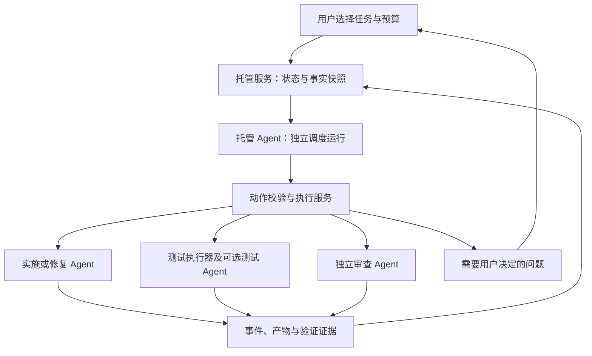

# 52 - 任务托管 Agent 设计方案

> 日期：2026-11-02  
> 状态：首期闭环及独立页面已落地（2026-11-03）；2026-11-04已增加Windows本机Codex 0.166.0、CodeBuddy 2.177.0并通过真实多任务测试。全部环境兼容仍未完成，最新状态见[兼容方案 §7](./56-任务托管Agent多环境多CLI兼容方案.md#7-当前状态)；验证结果与使用方式见 [54-任务托管Agent实施记录.md](./54-任务托管Agent实施记录.md)。本文中的后续扩展不代表当前可用能力。  
> 范围：当前项目内，用户选中的一组任务。新增独立页面，稳定后再替代旧自动编排。  
> 审查记录：[53-任务托管Agent设计审查记录.md](./53-任务托管Agent设计审查记录.md)。
> 兼容目标修正（2026-11-04）：用户已明确要求接入项目现有全部环境与全部 CLI，不能将本机已开放组合作为最终范围；通用兼容设计及完成条件见 [56-任务托管Agent多环境多CLI兼容方案.md](./56-任务托管Agent多环境多CLI兼容方案.md)。

## 1. 已确认需求

| 编号 | 需求 |
| --- | --- |
| R1 | 用户选择任务，托管目标固定为完成这些任务，无需另填目标。 |
| R2 | 一批任务可能互不相关；不得强制把它们串成业务流水线或继承全部对话。 |
| R3 | 托管 Agent 决定每项任务的执行范围、执行方案、调度顺序和异常处理。 |
| R4 | 托管 Agent 根据任务内容制定不同的验收计划，并根据证据决定通过、补测或返工；不要求用户事先编写或逐项批准验收条件。 |
| R5 | 用户能够设置资源预算，并暂停、停止或接管托管过程。 |
| R6 | 默认复用当前项目的 CLI、认证和模型档案，不强制另配 API Key。 |
| R7 | 托管 Agent 只负责观察、决策、派发和验收调度；具体代码修改、命令执行和浏览器操作由执行角色完成。 |
| R8 | 托管 Agent 的正常输出、实际派发内容、动作结果以及其他 Agent 的过程可实时查看，刷新后可回读。 |
| R9 | 新增独立“任务托管”页面，参考旧页面的布局，不直接改造旧自动编排页面来承载新功能。 |
| R10 | 可恢复故障自动处理；单项任务失败按实际依赖和资源影响阻塞，不直接冻结整个项目。 |
| R11 | 服务重启后能够恢复，不能重复派发已启动的工作；用户停止后不得自行重启。 |
| R12 | 两套功能并存期间，同一任务只能由一个调度来源管理。新功能稳定后，再单独执行旧入口下线和历史处理。 |
| R13 | 接入项目已有全部 Runner 环境及全部 CLI，复用 CLI 管理与登录配置；调度、实施、审查允许选择不同 CLI，不以 Windows 本机 Claude 作为最终交付范围。 |

托管 Agent 的“执行边界决策”是决定实现所需的模块、文件和操作范围，仍受项目规则、平台权限和用户授权约束。它不能自行提升权限、忽略 AGENTS.md，或把完成任务解释为提交、推送、发布授权。

## 2. 当前实现核查与改造前提

下列结论来自当前源码。旧文档中的目标不能作为已实现事实。

| 当前事实 | 源码位置 | 对新设计的影响 |
| --- | --- | --- |
| 普通 Task、TaskRun、Run 已分离；Task 没有独立验收条件字段 | `apps/control-server/internal/app/task.go` | 复用任务身份和执行历史；验收计划属于新托管域，不重新要求用户填写任务表单。 |
| Run 成功时，应用级 `auto_review` 可以直接将普通任务置为 done | `task.go: finishTaskRunTx` | 托管任务必须排除旧自动验收路径，等待托管验收服务处理。 |
| 编排正常收尾已不调用自动验证和独立审查，worktree 模式进入待合并 | `orchestration.go: completeOrchestrationImplementation / resumeCommittedOrchestrationReview` | 不能通过开启旧配置来获得新验收闭环。 |
| 编排失败设置项目级 `frozen_reason` | `orchestration.go: failOrchestrationJob` | 新托管使用自身阻塞原因与资源状态，不写旧冻结字段。 |
| `task_execution_intents`、`verification_runs` 绑定旧编排 job | `orchestration.go: migrateOrchestration` | 不能直接拿新托管 ID 填这些表；需要新归属模型或抽取公共执行服务。 |
| 当前派发使用 `worktreePath != ""` 推导 `orchestrated`，并切换到旧编排依赖规则 | `task.go: dispatchTaskByIDInWorkspaceWithExecutionIntentForConversation` | 必须显式表达派发来源；传入工作目录不应自动代表旧编排。 |
| AI owner 之间可共享同一目录租约；Git 暂存另有索引锁 | `app.go: acquireWorkspace`、`git_operations.go: workspaceLeaseCompatible / acquireGitIndexLock` | 当前租约并非托管需要的排他保护。新准入检查必须覆盖普通 AI、旧编排和平台 Git 写入。 |
| 会话隔离工作区、工作目录解析及按目录计算的 lease key 已存在 | `conversation_workspaces.go` | 可复用解析和身份校验，但不把会话 worktree 表直接当托管任务模型。 |
| 只读 Agent 调用、项目档案选择、额度准入已存在 | `insights.go: runReadOnlyAgentWithSchema / projectRuntimeProfile` | 可复用底层选择与权限机制；现有简略进度 sink 不足以展示完整托管过程。 |
| 普通会话已有消息、事件、Run 和实时通道 | `claude_runner.go: AgentRunRequest / AgentRunSink` 及现有 conversation API | 托管角色也要持久化正常输出和调用过程，不能仅写最终摘要。 |
| checkpoint 成功回合快照使用影子 Git 仓库，内部执行 add/commit | `checkpoint.go: createWorkspaceSnapshot` | 不能无条件复用为“完全不发生 Git 写入”的验证快照。新验收使用内容指纹，不依赖创建提交。 |
| 只读分析持有凭据额度，直至调用结束后的 cleanup 释放 | `insights.go: reserveInsightQuota / runReadOnlyAgentWithSchema` | 调度输出动作后必须先结束本次运行并释放额度，再启动下游；不能在流式回调内等待执行 Agent。 |
| `ask.pending` 可以让 CLI 回合等待用户回答 | `ask.go: beginAsk / answerAsk` | 执行 Agent 的业务问题要有托管交接协议，不能让唯一额度和工作区永久挂在待回答回合上。 |
| 项目运行的 running 状态在进程启动成功后发出 | `project_runner.go: projectRunner.start` | 进程存活不能替代 HTTP 就绪、功能健康或“运行了当前代码”的证据。 |
| 当前启动先恢复中断 Run，之后才恢复旧编排并启动定时循环 | `app.go: NewServer 启动流程` | 新托管保护必须在通用恢复改写任务和启动任何调度 worker 前建立，不能只在 HTTP 开放前补锁。 |

关联背景：[07-任务编排与人工下发.md](./07-任务编排与人工下发.md)、[14-严格串行Dev集成任务编排方案.md](./14-严格串行Dev集成任务编排方案.md)、[31-项目多会话Tab与工作区隔离调研及实施方案.md](./31-项目多会话Tab与工作区隔离调研及实施方案.md)、[39-后台任务与回合边界.md](./39-后台任务与回合边界.md)、[48-会话回退节点机制与语义.md](./48-会话回退节点机制与语义.md)。这些历史文档若与当前源码不同，应按本文列出的改造前提核对。

## 3. 架构选择与首期取舍

| 方案 | 评价 |
| --- | --- |
| 持续扩展旧固定编排 | 可复用部分机制，但其串行队首、项目冻结和人工合并语义不适合直接承载新需求。 |
| 给调度 Agent 任意命令及文件写权限 | 灵活，但会混淆调度和实施，难以保证预算、幂等和恢复。 |
| Agent 决策、后端执行受限动作 | 采用。业务判断交给模型，状态、权限、幂等、预算和进程收敛由服务保证。 |

首期明确选择：

- 一个项目最多有一个已启动且未结束的托管会话；暂停或等待用户的会话仍占用这个名额。未启动草稿不认领任务或占用目录，可以保留多个。
- 使用项目当前工作目录，接受其中已有的未提交改动，启动时记录基线；代码实施、测试和审查访问该目录时串行。
- 每项任务使用独立实施会话和验收记录；共享目录不代表共享全部聊天上下文。
- 创建页只列出 todo/action_required 任务。看板或 URL 预选按当前任务列表过滤并去重，提示已删除或当前不可托管的预选项；没有有效任务时不能创建。创建和启动时后端仍重新核对状态，不能仅依赖页面过滤。
- 任务选择由托管 Agent 决定，不能因为队首任务等待就阻塞其他就绪任务。
- 不自动创建项目提交、切分支、合并、推送或发布；不自动回滚目录。成果保留在工作区。项目明确禁止的 Git 写入也不得通过影子仓库或自动 checkpoint 间接发生。
- 首期支持服务端本机 Runner；跨环境 WSL、SSH 和云端远程执行不在本次交付范围内。支持与否以服务端能力判断为准，不能仅按客户端平台推测。
- 首期调度、实施与独立审查使用通过能力校验的本机 Claude Code，复用项目认证与模型档案。Codex 适配仍未开放，不能因为普通对话支持 Codex 就认定其满足托管契约。
- 浏览器验收是按任务要求启用的能力。没有执行器或环境时明确标记缺失，不能把构建通过当成界面行为已验证。

这是为第一版可靠闭环选择的工作区策略，并非宣称无关任务应永久共享目录。后续独立任务 worktree、并行实施及成果集成，需要另行实现基线传递、冲突处理和交付语义后再开放。

## 4. 角色与组件



| 组件或角色 | 职责 | 不承担的职责 |
| --- | --- | --- |
| 托管 Agent | 分析任务、制定计划和验收方式、选择就绪任务、派发、诊断、决定返工与验收 | 修改文件、任意 Shell、浏览器实际操作、自行放宽平台权限 |
| 实施 Agent | 按下发内容实现或修复，报告变更和自测情况 | 自行验收通过、替其他任务变更状态 |
| 测试执行器 | 在指定目录运行已批准的验证规格，保存退出码、输出和产物 | 根据“进程正常退出”断言需求已实现 |
| 测试 Agent | 需要时编写测试或进行浏览器验证，产出可核查证据 | 修改验收标准来掩盖失败 |
| 独立审查 Agent | 以独立会话核查任务内容、diff、验收覆盖和测试证据 | 直接修改代码、复用实施会话作为独立审查 |
| 托管服务 | 生命周期、任务归属、事件游标、预算、状态投影、恢复 | 从自然语言输出直接猜测并写入 done |
| 公共执行准入服务 | 工作目录、权限、角色能力、额度、唯一执行意图与 Run 关联 | 绕过普通派发或旧编排的资源占用 |

测试 Agent 是需要模型判断的扩展角色；当前需要新增测试代码时派发实施角色，真实测试命令及浏览器操作由固定执行器运行，不伪装为 Agent 对话。三个模型角色默认复用项目 Claude 配置，也可分别覆盖认证档案、模型和思考强度；实施与独立审查始终使用不同会话。写入 scope 不限制必要的只读上下文：角色输入补充任务/计划提到的已知文件和实际验证入口，提供对应启动基线；审查可通过 request_review.paths 显式附带最多 50 项可读源码路径。小项目传递完整清单，大项目优先保留相关项、上限 2000 项并标明截断，另提供整批相对启动基线的文件变更及截断标记。配置覆盖不扩大 CLI 已验证的能力范围。

## 5. 使用流程

1. 用户在任务页勾选任务进入“任务托管”，或在新页面中选择任务。
2. 启动卡只要求任务、调度 Agent 和预算。调度 Agent 默认沿用项目配置；无需填写目标、执行范围和验收条件。尚未开始时为 draft。
3. 用户点击开始后，服务端一次校验并认领选中任务，保存描述、已有依赖、项目规则来源和预算快照。任一任务不合格则整次启动失败，不静默丢掉部分选择。
4. 后端等待已有目录写入结束，建立托管排他准入，再记录代码基线。CLI 不可用、目录有未结束合并等前置问题返回可解释状态。
5. 托管 Agent 逐项分析，生成任务执行方案、验收计划及任务关系。正常任务自动推进，不逐项等待用户批准。
6. 选取一个就绪任务实施，完成后安排验证和独立审查。失败时按原因安排修复或等待，其他就绪任务仍可调度。
7. 单项检查通过后记录 `accepted` 候选。后续写入会使证据过期，但不抹掉实施完成事实；结束前统一完成最终快照上的验证，之后才把任务领域状态正式置为 done。
8. 全部选中任务在最终快照上通过验收后，会话完成。存在未解决任务时，明确展示部分成果、未完成项和原因，不能显示“全部完成”。

## 6. 任务范围、依赖与上下文

### 6.1 可选任务与编辑规则

首期只允许选择同项目的 `todo`、`action_required` 任务，且不存在活动 TaskRun、旧编排占用或其他托管认领。已完成、待人工验收和执行中的任务不隐式接管；用户先在原流程处理到可接管状态。

被托管认领期间，普通任务编辑、删除、手动下发、批量验收、重新打开和旧编排入队均须经过统一归属检查。用户通过托管页补充要求，形成版本化任务指令；不得直接改写已执行快照。

依赖 API 的检查必须覆盖边的两端：不能从未托管任务的接口绕过保护，修改被托管任务参与的关系。外部已完成前置若被重新打开或要求发生变化，订阅其事实并使后继依据失效；最终验收事务再次检查外部依赖，不能只读取启动时 done 的快照。

补充要求会增加 `requirements_revision`，相关方案与证据重新校验。已经运行的实施不注入并发新回合；用户可以选择让当前运行结束后应用，或停止当前运行后重新安排。

补充消息先保存为不可变指令，显式绑定本次会话或指定任务，不能凭“当前选中的 Agent 标签”推断影响范围。选择回合后应用时记为 pending amendment，不立即改写活动工作项的要求版本；先阻止受影响的新派发，旧工作项按原版本结束，输出和代码变化仍如实保存，再原子启用新要求并作废相应旧计划/证据。选择立即应用时先停止并确认当前运行收敛，再启用新版本。用户消息不能因模型归纳而丢失明确限制；影响范围有歧义时询问，不能自行解释成全项目授权。

首期运行中不新增或移除选中根任务。需要变更根任务集合时，停止当前会话并新建；修复和补测可以创建内部工作项，仍归属原选中任务。

### 6.2 任务关系

- 原任务中显式记录的前置关系继续有效，Agent 不能删除或绕过。
- 未选中的前置任务已 done 时读取其事实；未完成时只阻塞对应任务，不能自动把它加入托管范围。
- Agent 可推导托管内部依赖，保存在托管计划中，必须说明依据；校验原始边与有效推导边的合并图无环，不是分别检查两张图。并发关系修订使用同一状态版本和事务，不能分别通过后合成环；不自动改写用户维护的原任务依赖。
- 同一托管会话内，前置任务的有效 `accepted` 候选可满足内部派发条件；服务端在后继启动时保存前置任务、计划、证据和代码快照的 `dependency_basis`。这个规则只对同一托管所有者生效，不能放宽普通派发。
- 后继自己的写入使前置证据过期时，当前已启动工作项可以收敛和完成自身验证，不因这次预期写入追溯撤销派发资格，也不自动重做前置实施。
- 对尚未启动的后继，直接前置证据若已过期，先在当前快照重新验证直接前置；失败或明确返工会阻塞后继。已经执行的后继保留成果，但最终验收必须重新核对依赖。
- 证据过期与实际验证失败不同。过期只设置 freshness 标志，不能把整个依赖链退回“待实施”或反复重新派发。
- Agent 推导的依赖可以有理由地修订；原始依赖只有用户在退出托管后才能修改。

依赖门禁区分写入与取证：首次实施、继续实现或代码修复需要核对派发依赖；只读审查和验证已有成果不要求前置任务先被最终接受。重新验证 B 时，如果 B 原本基于有效 A 派发、A 仅因后续代码写入而 stale，可以验证 B 并保存新的局部证据，无需先层层接受所有祖先。局部证据不能据此放行依赖实际失败的实施，也不直接写 done。最终验收先独立采集所有候选的当前证据，再统一求依赖闭包，避免菱形依赖中复测互等。

任务业务上独立不代表文件、端口、数据库或测试环境独立。资源冲突由后端和执行计划共同处理，不能凭“无依赖”开放同目录并写。

### 6.3 上下文传递

每项任务接收自己的任务快照、项目规则、允许范围、验收计划、当前代码基线及必要前置成果。默认不继承其他无关任务的聊天。返工可复用该任务实施会话，但必须附上具体失败证据；独立审查总是独立会话。

托管 Agent 读取结构化项目状态、任务摘要和证据索引，按需获取限定长度的日志或文件。长时间托管的记忆保存在数据库，不依赖永久存活的 CLI 进程或无限增长的聊天上下文。

## 7. CLI、认证、权限与运行方式

- 沿用项目 Agent 路由、档案、模型与目标环境解析，支持现有 `cli_managed` 或 `api_key` 方式；无需为了托管额外配置 Key。
- 会话启动时固化角色配置和路由版本。固定档案绑定其版本；账号池固化池/路由版本，每次实际准入在其中选择并记录具体档案版本，不能同时宣称会话绑定唯一账号和每次动态选池。档案撤销后不能继续用被撤销凭据，转等待配置处理。
- 不依赖 CLI 原生子 Agent 功能。平台分别创建调度、实施、测试、审查运行，并关联到同一托管会话。
- 托管 Agent 每次是独立的一次性决策运行，接收当前事实与必要历史；页面上保持连续的逻辑对话。
- 调度进程没有文件写入、任意命令和项目外部 MCP 权限。资料由平台受限读取后绑定快照输入，或通过已验证隔离的只读资料接口提供；不能仅开放 CLI 的任意只读工具。调度输出版本化结构化动作，平台执行动作并回写实际结果。
- 独立审查使用只读权限。测试和实施权限由实际角色和项目策略决定，不能沿用旧编排的 full_control 作为默认。
- 不同 CLI 必须通过角色能力检查：只读限制、事件归一化、结构化结果校验、取消和用量信息。未知能力明确拒绝，不能静默切换到其他 CLI。
- 一次性运行也保存 Run、用量、正常助手输出和可见工具事件。不能沿用只收最终字符串、运行结束就删临时记录的简略分析封装。

模型运行与下游执行之间必须先交接资源：调度或审查回合结束、进程退出/持久 Session 空闲并释放本轮额度后，才允许执行服务启动下一个角色。不能在 AssistantText 回调内同步启动并等待子工作项，也不能在模型仍占唯一账号并发额度时等待下游完成。

额度并发为 1 时，角色顺序执行是正常情况。单轮后端等待、进程核对和用户停止不需要调用模型。保留空闲原生 Session 的会话上下文，不代表保留其工作目录写入权或本轮凭据额度；无法可靠释放时必须关闭该 Session 后再交接。

角色能力要用实际 CLI 版本建立测试记录。当前 Codex 的 read-only sandbox 主要限制写入，并不自动等同于“没有任意命令工具”；Claude 现有只读 deny 清单也有版本适用范围。调度角色只有在工具禁用或受控资料输入模式下满足“无执行能力”才开放；仅靠提示词或文件只读模式不足以证明。不能满足时该 CLI 的调度角色显示不可用，实施支持不受其调度角色不可用的推论影响。已有 CLI 登录、结构化输出或 read-only 参数，均不能代替角色能力实测。

多环境适配中的隔离只读方式也须遵守上述限制，输入绑定不可变工作项资料，不读取未授权的实时项目；具体边界见[兼容方案 §3.2](./56-任务托管Agent多环境多CLI兼容方案.md#32-cli-适配器)。当前未满足角色权限的组合是待解决的兼容缺陷，不据此缩小六种CLI的目标范围。跨端控制授权、部分写入和最终验收交接还须遵守该方案 §3.6—§3.8，不能把本机事务或单文件原子替换误当作远程多文件事务。

进程所在机器和凭据必须匹配。页面关闭后后端继续工作；服务端关机时无法执行；重新启动时走恢复流程。

## 8. 决策与动作协议

### 8.1 决策触发

任务结束、检查失败、资源释放、用户补充、预算变化和重试到点触发决策。事件先落库，再发送唤醒信号；WebSocket 只用于展示，不能承担可靠调度。

后端合并同一状态版本的重复唤醒，一个会话最多有一个决策运行。另有每 30 秒执行的状态核对，修复漏唤醒；健康且无变化时不调用模型。已登记等待的到期复查是独立、有限的决策触发，不受旧 applied 动作去重永久阻塞。

调度 Agent 可以在实施运行期间基于已保存证据进行不读实时文件的判断，但不能并发启动另一项目录操作。需要读取目录时等待执行器释放相应目录保护。

### 8.2 动作集合

| 动作 | 含义 |
| --- | --- |
| `record_plan` | 保存或修订执行范围、任务关系、验收计划；保留版本和原因。 |
| `dispatch_implementation` | 启动选中任务的一次实施或返工工作项。 |
| `request_verification` | 运行具体检查规格，或安排测试 Agent 产出验证证据。 |
| `request_review` | 启动独立审查，绑定要求版本、验收计划和代码快照。 |
| `record_acceptance` | 记录通过或不通过的候选决定；后端检查证据，不能直接将 Task 置为 done。 |
| `record_task_disposition` | 记录任务 blocked/unresolved 及具体依据；预算部分收口由服务端记录 deferred，不能跳过根任务后宣称全部完成。 |
| `cancel_work_item` | 请求停止本会话持有的指定工作项；先确认停止，再决定诊断、返工或等待。 |
| `wait` | 指定等待原因，后端登记60秒后的复查；每30秒核对源码、规则及已登记依赖，到点有限重新判断，不能把任意条件文本当成已实现的外部监测器。 |
| `ask_user` | 保存具体问题、影响及可选方案，等待显式回答。 |

每次决策返回一个版本化 JSON 对象，包含 `schemaVersion`、`decisionId`、`expectedStateVersion`、依据的事件游标和一个动作。读文件等只读工具事件另行记录；首期不接受一个输出携带多项不可分割的执行动作。

`decisionId` 由服务端生成并随请求下发，模型只能回传当前 ID。`stateVersion` 在任务事实、有效计划、权限、预算配置、用户控制等业务变化或已登记等待复查到期时递增；助手流式文本、进度、日志、心跳、普通经过时间和页面订阅不会递增。本次决策自身的调用预算预留和用量结算不使自己的输出过期，预算准入仍在执行时独立原子复核。其他工作项完成、用户降低预算或要求变化会正常使决策过期。事件 seq 仍对所有持久化事件递增，两者用途不同。

动作携带明确的 session/task/work-item ID、要求版本、计划版本和工作区快照 ID。动态命令由 Agent 形成具体验证规格后交给执行器，必须走项目权限与审批规则；后端不从任意聊天文本提取命令执行。

合法计划使任务从 planning 进入 ready；阻塞解除后回到原阶段。blocked/unresolved 都需要原因和证据，unresolved 表示本会话已无可用自动处理路径。服务端依据这些事实触发最终验收或等待，不把某次助手结束当成会话结束信号。

执行日志、仓库文件及其他 Agent 汇报属于待分析资料，不具有修改平台规则或授予新权限的效力。任务下发中的项目规则与用户明确要求保留独立来源，不能被执行输出中的指令覆盖。

### 8.3 执行与幂等

执行前校验：同项目、选中范围、角色权限、依赖、任务归属、预算、状态版本、代码基线及停止标记。

决策、动作意图、预算预留和 outbox 在同一事务写入；启动器认领意图并以稳定 `execution_id` 启动。Run 与执行意图在现有发送事务中建立唯一关联。重试读取既有结果，不新建重复 Run。

数据库唯一键覆盖：`(session_id, decision_id)`、动作幂等键、意图 ID 与 Run ID 的一对一关系、同任务活动认领。状态版本过期时返回 `stale_state` 并重新观察，不当成任务实施失败。

不承诺外部副作用 exactly-once。启动中断且无法确认进程或远端动作结果时，标为 `outcome_unknown`，先核对后决定，禁止直接重跑可能修改外部状态的命令。

JSON 无效最多修正两次，计入调用预算；仍无效则记录调度故障并等待用户处理，不能盲目重启实施。用户补充或停止后，旧决策即使稍后返回也失效。

防止合法但无进展的循环：同一决策/动作的传输重放只返回已有结果，不再次调用模型；新的模型输出重复请求已经提供的同一资料或记录完全相同的计划时，保留计划/业务版本，返回明确领域纠正，最多两次纠正后仍重复则进入 needs_input/no_progress，不能停留在running却永久不再调度。旧版已提交的同版本无效进展读取/计划可识别并进入相同有限纠正，不重放旧执行。重写计划说明、刷新日志或更换角色不算进展；不能靠不断 record_plan 消耗完整预算。独立审查另按真实输入指纹限制：相同任务、要求、计划内容、当前/基线源码、非审查证据和实际可读资料最多实际启动3次；措辞、任务阶段和旧审查输出不刷新次数。增加新资料、真实验证或代码变化后允许继续，取消的 queued 工作不消费实际次数。

等待持久化条件、绑定业务版本、下次复查时间及相同事实下的等待轮数。源码/规则变化仍要求明确接受；外部前置及验证环境改变使旧版本失效并触发新判断。没有新事实时到期可再判断，连续三次选择等待后进入needs_input/no_progress，不能只换条件措辞清零。复查不解除用户暂停/停止、不改变最终验收阶段、不返还调用预算；旧版已应用等待可以补建持久复查记录。页面显示等待原因和下次复查时间。复查由30秒维护周期触发，时间不是精确计时器；没有接入的外部业务状态或网络条件仍需用户提供事实，不能声称任意等待条件都能自动监测。

### 8.4 调度代际与启动时复核

会话调度 lease 使用持久化 `owner_id`、递增 `lease_epoch` 和到期时间；每个决策、outbox 认领、状态写入及启动请求都携带当前 epoch。续租失败立即停止该调度者产生新动作；旧调度者迟到的结果只能作为历史观察保存，不能改变当前状态。

意图入队时检查一次不够，启动器真正启动前还要复核 epoch、stop/pause、任务要求、目录准入、依赖和预算。恢复后也必须先核对旧活动工作项，不能凭 lease 换代立即再启动同一目录的写入。平台单进程数据锁继续保留，不能用 lease 代替对真实子进程的核对。

复核与实际启动之间还有间隙。每会话使用统一的 launch/control gate，将“确认允许并持久化 launching”和“提交 pause/stop”排序；持有 gate 不等待模型或长时间进程运行。启动后登记进程身份也经该 gate 完成。pause/stop 若先提交，后续启动被拒绝；launching 若先提交，控制请求把该握手视为活动执行，阻止尚可撤销的启动，并在进程登记时再次施加控制。已经实际启动时，pause 等它按 §11.3 收敛，stop 则取消执行；不能为了实现暂停而误杀已经运行的工作项。握手未核对完成前不能返回 stopped/paused，防止晚启动进程继续写入；停机恢复继续按 launching 身份核对，不能把有记录的握手当作尚未启动。

未启动意图按原因转为 suspended 或 cancelled。用户暂停时意图 suspended，继续后可保留同一逻辑意图 ID，但必须核对没有已启动尝试，并在当前 epoch、要求、快照和预算下重新授权；不能把旧授权令牌原样放回队列。输入事实变化时取消该旧意图，由新决策生成替代动作。停止、要求版本失效和归属释放时意图 cancelled。两者都禁止启动器重试直接执行。

### 8.5 执行 Agent 的提问与审批

区分平台授权审批与业务问题。授权审批仍走既有审批机制，托管 Agent 不能替用户批准需要人工授权的动作；CLI 内等待时间受回合上限和总预算约束，到期记录未获授权，不视为实现缺陷。

业务问题优先交给托管 Agent：实施/测试角色将问题、可选项和当前进度以结构化结果交回，并结束本回合、释放额度和工作项资源。托管 Agent 可在原任务及现有授权内自行回答，再新建继续工作项；无法决定时保存持久化 question 并 ask_user，其他就绪任务仍可推进。

若 CLI 先产生既有 ask.pending，适配层将其关联到托管 question。允许用户在原等待窗口内直接作答；窗口结束或需交给托管判断时，结束等待并确认原运行收敛，再进行后续决策，不能在原执行仍占唯一额度时启动另一个模型来回答。未授权、超时、交回问题和代码失败分别计数，交回问题本身不消耗修复次数。

question 带稳定 ID、task/work-item/run、要求版本、状态和回答来源。回答只应用于匹配版本的未结问题；重复提交幂等，停止或要求变更后的迟到回答保留历史而不触发执行。重启不恢复已经失效的 CLI waiter，只恢复业务问题事实。

## 9. 工作区、基线与资源保护

### 9.1 首期目录策略

首期使用项目当前目录，不自动改变 HEAD、分支或暂存区。开始时记录分支/HEAD（若有）、已有改动、源文件内容清单与可验证环境信息。无 Git 项目也可使用文件指纹模式。项目自带 Git hook、测试或 CLI 自动提交行为同样受策略约束，不能只限制平台主动发出的 Git 命令。

托管期间只允许一个目录执行工作项；测试可能写构建产物、缓存或数据库，同样按有副作用操作管理。只读审查需要稳定输入，在写入工作项结束后进行。

新增托管排他准入，与现有目录 lease 组合使用。普通 AI、手动 Task 派发、定时任务、旧编排、平台文件写入、Git 写入、工作区切换、回退、终端命令和项目运行命令都必须检查实际目录是否由托管持有。未完成接入的入口存在时不能宣称稳定快照已得到保护。

普通浏览、读文件、查看历史不受影响。同项目其他真正隔离的目录不被无差别冻结。已打开的终端、开发服务和外部编辑器无法仅靠平台租约控制：启动时识别平台管理的活动进程；外部改动通过指纹复查识别。只读展示不代表目录绝对没有外部写入。

托管排他准入由本次会话持有，执行工作项以子令牌使用，不能按普通 AI 共享 owner 规则绕过；Run 结束后还须确认未登记的原生后台任务、后裔进程和输出管道收敛，才释放工作项资源。显式登记的验证资源按 §9.4 管理，不能把所有长期服务都当作未收敛进程，也不能把任意后台进程都豁免。

已有的非托管普通写入完成前，启动请求先原子建立 pending 目录准入，阻止新写入插队；之后等待旧持有者收敛，再升级为 owned。任务认领、pending 准入和会话 running 在同一启动事务中提交，重叠目录冲突则整次回滚，不能留下半认领。等待超时、用户停止或前置条件失效时显式撤销 pending；不能抢占已有工作或无限等待新写入不断到来。

### 9.2 内容指纹与证据有效性

目录准入按实际规范路径和覆盖范围判断，同一目录的大小写、路径别名、符号链接以及父子目录重叠不能形成两个互不相干的锁。无法可靠解析的路径明确拒绝。跨 Project 指向同一实际目录时也必须互斥。

`WorkspaceRevision` 只标识规范化目录身份、代码与配置文件清单、内容哈希及影响行为的文件元数据。清单区分普通文件、目录与链接，记录链接目标及适用平台的执行权限；只有内容未变但执行位或链接目标改变，也须识别为版本变化。mtime 不作为内容相同的证明。`VerificationContext` 另行标识工具版本、依赖实际安装状态/安装记录、启动规格、外部服务和测试数据基准；每份证据记录其资源实例及 environment epoch。任务要求版本和验收计划版本也由证据另行绑定，不能把不同任务的计划版本或每次启动的随机端口混入物理代码快照身份。Git HEAD 仅为辅助信息。

执行前后和验收提交前记录指纹；新增、删除、未跟踪但属于验证输入的文件均纳入。默认排除 `.git`、依赖目录、构建产物和缓存，但依赖锁文件、测试配置及验收所需的被忽略源文件必须显式纳入。二进制输入可哈希；不可读取、越界、符号链接未解析或超限的必要输入记录为覆盖缺口，不能按“无变化”处理。

验证结果绑定文件快照、环境和命令规格版本。后续实施或外部修改使已有证据过期。首期保守地将托管已接受候选全部标为需复核，不实现未经验证的文件影响图优化。

依赖目录虽然不逐文件复制，也不能只检查 lockfile 就假定 node_modules、虚拟环境或工具链没有变化；至少记录实际版本、依赖安装标识和验证前置检查。无法确认的环境漂移显示为环境覆盖缺口。相同代码下环境规格改变会使相关证据过期。

环境扫描的依赖和缓存名称匹配应与源码快照的大小写策略一致。Windows上 `NODE_MODULES`、`.VENV`、`VeNv` 等仍参与真实依赖核对，不能在源码和环境两处都被遗漏；可重建缓存名称的大小写变化也不能无故作废已取得的证据。依赖里的构建代码仍需核对，不因其位于 `dist/build` 而跳过。

验证步骤应声明允许生成的目录和文件。测试结束后源码或配置指纹变化则本次证据无效，须重新验证；仅允许的构建产物变化不使源码指纹失效。为避免读取过程中的混合快照，清单采集前后校验输入稳定性，变化则重采集，不拼成虚构版本。

仅有哈希无法重建未提交基线的 diff。启动时为纳入验收输入的普通源文件保存一次内容寻址基线，后续只保存有变化的源文件内容与清单，在应用数据目录去重存储；不为每次决策复制全项目。保存前沿用敏感文件排除规则，必要但被排除的输入显示覆盖缺口。每个实施工作项关联输入与输出清单，审查既能区分启动前用户改动，也能查看当前任务前后及整批相对启动基线的变化。

哈希和内容留存不是自动回滚承诺。首期不自动恢复或删除失败任务改动，也不直接调用 checkpoint 的影子 Git 提交链。托管角色接入现有 Run 收尾时，必须显式控制自动 checkpoint 副作用，不能因复用成功回调绕过项目规则。大文件、必要输入不可保存或空间不足时明确限制 diff 覆盖，不得默默仅与 HEAD 比较后声称已审查用户当前基线。

平台只能证明采集和验收时观察到的版本；外部编辑器不受平台锁控制，无法提供跨文件系统与数据库的绝对原子冻结。检测到采集期间或验收提交前改动时拒绝落库，记录外部修改并重新验证；已结束报告保留被验收的快照身份，不保证未来目录仍相同。

实现前后检查范围、规则和权限漂移：修改项目规则文件不能自动扩权；超出已下发模块/文件范围的变更要先记录调整方案并重新校验。已经发生的越界变更进入审查或用户处理，不静默接纳，也不自动 reset。CLI、运行环境、项目目录或 Runner 变化时暂停相关执行并重新准入；固定项目路径不能指向被移动或替换的另一目录。

### 9.3 失败后能否继续

任务失败后先确认进程结束、目录可用、改动可归属、没有未结束的 Git 操作或外部副作用。托管 Agent 判断失败残留是否影响下一任务，并记录依据。

仅任务语义受阻且目录仍可用时，可以调度其他就绪任务；目录状态不确定、后台写入未结束或共享测试环境损坏时，该资源上的任务等待。前者不写项目冻结字段，后者也不能为了“继续推进”冒充资源已恢复。

进程终止后服务仍须保留最后一次可见状态；无法确认终止时显示 `outcome_unknown`，不能单纯因为锁超时就交给下一任务。

这里必须拆开进程事实和结果事实：`process_state` 为 launching/running/quiescent/unknown，`outcome_state` 为 pending/known/unknown。进程 unknown 时禁止在该目录启动任何可能写入的工作；进程已 quiescent 而结果 unknown 时允许受控只读诊断与代码/日志核对，不因此重启原动作，也不把当前实现算通过。

重跑由副作用类别决定：只读检查或隔离且已重置的测试，在预算内可创建新尝试；实现中断先检查已有 diff，再派发“继续或修复已有成果”，不盲目重做整个任务；不可逆或无法确认的外部动作保持阻塞，只能通过核对或用户明确的处置指令解决。失败动作影响范围可证明不涉及其他任务时，其他就绪任务仍可推进。不能把 outcome unknown 一律等同于目录永远不安全，也不能把进程退出等同于副作用没有发生。

### 9.4 验证环境与临时资源

浏览器验证或接口测试可能需要启动开发服务、测试数据库或监听端口。由托管执行器创建 `verification_resource`，记录所有者、进程组、目录、代码快照、启动规格、端口、数据命名空间、就绪探针和清理动作。资源属于当前验证轮次，有独立身份，不能以“CLI 进程还活着”推断已经可用。

资源启动后，先确认端口属于预期进程，再通过有上限的就绪/健康探针；浏览器或测试只连接被记录的实际服务地址。检测到用户已运行的服务，不自动停止、复用或修改它；只有能证明环境及代码版本吻合且获得既有策略允许时才能复用，并将其标为非托管拥有。

一个验证组可以顺序执行启动、探针、测试/浏览器、取证和清理子步骤，受同一工作项预算与取消控制，步骤分别持久化。预期存活的登记服务可供组内后续步骤使用；不因此开放第二个代码实施。验证组结束前停止自有临时服务并确认收敛，或显式转交下一验证组；外部服务只解除关联，不代为关闭。

测试数据库/外部状态使用可区分的测试命名空间或可验证重置步骤。测试顺序会影响结果时在每项前恢复同一基准，保存环境 epoch，避免 A 留下的数据使 B 虚假通过；生产或不可逆外部操作不作为默认自动验收动作。

同一最终代码快照上的不同任务可以使用各自隔离的资源实例和 epoch；只要满足各自相同的验证环境规格与数据基准，就不因前一个验证组正常启动/清理而互相失效。资源变化若修改了共享依赖、服务配置或实际基准，则重新验证受影响项。目录隔离不能替代端口和测试数据资源准入，其他隔离 worktree 的进程也要核对资源冲突。

暂停、停止、预算到点和重启都核对资源清单。资源清理由后端执行，不需要模型调用预算；清理失败显示资源问题并保留目录保护。进程存活、HTTP 就绪、功能健康和通过验收是四种不同事实。

## 10. 动态验收与最终完成

### 10.1 验收计划

每项任务在实施前生成版本化计划，包含：任务预期结果、允许修改的范围、每条验收点的验证方式、检查规格、所需环境、需要独立审查的内容及无法自动验证的部分。普通任务无需用户逐条确认。

任务类型决定验证方式：接口任务验证响应与异常路径；界面任务验证实际交互及必要的视觉结果；配置任务验证生效行为；重构任务检查行为保持及回归。不得统一套用“构建通过”作为全部验收条件。

检查规格与验收点类型必须一致：命令检查只绑定 command 验收点，浏览器检查只绑定 browser 验收点；同一任务需要两类证据时分别运行检查。派发前拒绝类型不符的规格，避免运行成功却无法生成对应的验收覆盖。

检查工作目录与实施修改范围分别校验。除项目根目录外，检查目录必须是当前快照中已存在的真实目录，路径及祖先不能越界、被排除或为链接；目录内存在依赖、敏感配置等排除项不妨碍在此运行检查，也不授予修改这些输入的权限。源码树内可枚举、但被源码快照排除正文的敏感配置文件只参与环境内容哈希，不把正文保存为源码或发送给模型；其新增、修改与删除均须使既有验证证据失效。

计划可补充和纠正，必须记录原因。删除或削弱验收点时，要解释与原任务的对应关系，交独立审查检查；与用户明确要求冲突时必须询问用户，不能由托管 Agent 自行消除要求。审查模型不能代替实际授权。

### 10.2 证据与门禁

| 证据 | 必须保存的内容 |
| --- | --- |
| 命令验证 | 规格及实际命令、目录、脱敏环境标识、开始结束时间、退出码、超时/取消状态、输出和产物引用 |
| 浏览器验证 | 实际执行的步骤、环境 URL 标识、断言结果、必要截图/录屏引用；未运行时明确缺失 |
| 独立审查 | 独立会话、验收点覆盖、阻塞问题、测试缺口、审查快照 ID、要求与计划版本 |
| 验收决定 | 对各验收点引用的证据、残余问题、决定和理由、实际通过门禁的快照 ID |

缺失结果与失败结果分开。CLI 正常退出、Agent 自称完成、无日志、日志被截断、缺少浏览器能力，都不能单独代表验收通过。

因暂停、取消或授权版本变化而未被采用的检查标记 `interrupted`，保留原输出与原因，不能参与验收覆盖或满足实施前基线要求；恢复授权后允许重新运行相同检查。真实断言失败继续作为失败证据并遵循重试门禁，不能用中断标记抹掉实际失败；实际运行过且未中断的失败基线仍可用于比较既有问题。

工具、目录或环境准备失败以及进程尚未真正启动时，检查标记 `notExecuted`；只有授权握手成功恢复进程后才清除此标记。未执行或没有实际退出结果的记录只作失败历史，不满足实施前基线、验收覆盖，也不阻止修复环境后重跑同一规格。基线还要求输出完整；有实际退出码且未中断、未截断的断言失败仍可作为原有故障的比较记录。浏览器规格必须在派发前提供受支持的独立测试服务程序及参数，不能等执行时才发现缺少服务。

环境核对同时覆盖实际运行的成功、失败与实施前基线记录。依赖或工具环境发生变化时，统一使此前证据失效并允许同一源码、要求、计划和检查规格重新执行；环境未变时仍禁止靠重命名检查反复运行。失效截止位置也约束基线授权，不能继续用旧环境基线允许实施；重跑后的新记录不被截止位置之前的旧失败重复作废。中断或未执行记录不参与该环境判断。

关键验收点缺证据、检查失败、未解释基线故障、阻塞审查问题、版本不匹配和越过授权，均禁止通过。用户可以明确豁免某项，但要记录用户身份、范围和理由，报告标为“带人工豁免”，不能改写失败证据。

基线已有失败必须有实施前可比较的实际记录，至少能识别同一用例/错误签名与环境；不能只根据 Agent 判断认定“以前就坏了”。原有故障不自动扩大选中范围；若阻碍关键验收，相关任务继续受阻。

计划声明需要区分原有故障的检查，应在该任务首次写入前完成一次可比较的前置验证，允许先做有界环境准备，但准备行为也要记录输入变化。没有前置运行记录时，实施后首次发现的失败只能标为“基线来源未确认”，不能事后补跑当前代码来证明以前已失败。资源不足无法前置验证时显示这一缺口，不强行对所有任务运行全量基线测试。

### 10.3 候选通过与最终落库

为避免后续任务破坏先前成果，单项先保存 `accepted` 候选，Task 保持 `awaiting_review`。托管内部可用候选解锁依赖，但普通任务页不能手动验收或重新下发。

没有可继续的实施、修复或待处理用户回答，且剩余任务已明确 unresolved 时，进入 `finalizing`；全部任务均为候选通过时也进入 finalizing。尚有用户问题时可以先等待回答；若按部分收口规则结束，问题必须保留为未解决并终止本会话的回答触发，不能擅自把问题视为已解决或让迟到回答重启终态会话。

已受理且尚未应用的补充要求必须先处理，再决定是否最终结束。延后要求允许当前回合交回旧结论，但不能因为最后一项旧处置使任务全部 accepted/unresolved/deferred，就跳过新要求直接写会话终态或 Task.done；其他任务的旧候选同样受此保护。要求应用后重新核对计划、证据、预算及控制状态，用户暂停不被自动解除。

达到实施份额上限但总预算尚有最终验收预留时，服务可进入 `finalizing` 的部分收口模式：尚未开始的任务标记 `deferred`，reason 为 `budget_reserved_for_finalization`；进行过但未具备候选条件的任务保留 unresolved 或 deferred 的具体依据。这是本次会话未完成项，不表示任务被取消或实现失败；根任务集合仍不变。未答问题可以记为未解决原因收口，不生成默认答案。没有任何候选成果且仍有可能推进的任务时，不消耗预留空跑最终验收，进入 paused/needs_input 请用户增加预算、解决问题或停止。

finalizing 的准入依据是实施完成事实、已有候选决定及未解决项分类，而不是“全部旧证据仍有效”。进入后针对同一最终目录快照复核候选任务的全部必要检查和独立审查。只有代码快照、要求、计划和验证环境规格都匹配的历史证据才可复用。验证组的预期测试数据重置及登记服务生命周期按 §9.4 处理，不把正常清理误判为全部检查永远失效。

最终验收期间不能再新增测试代码、自动格式化或修改源配置。需要这些改动时明确离开 finalizing，通过根任务的修复工作项实施，再重新建立最终快照；普通只读验证失败也回到相应任务诊断，只有实际需要代码修复时才消耗修复次数。允许的测试产物变化按 §9.2 处理。

已实施任务在最终验证或独立审查中失败，且仍有实施份额及该任务修复额度时，结果消费事务记录 `session.repair_reopened`，先切回 running，再由调度器决定修复、补充验证或交还。该转换不直接执行代码，也不返还次数或使用最终预留补贴实施；没有实施额度、修复次数耗尽、结果中断或用户已暂停/停止时不自动开放。

部分任务明确无法完成且预算仍足够时，可最终确认已完成子集，随后结束本次会话；预算已经耗尽时先按 §12.2 暂停，不能继续消耗预算做“免费验收”。未最终复核的候选不能算 done。

最终通过子集必须在依赖上闭合：每个通过任务的原始前置和仍有效的推导前置，要么属于本次同事务通过集合，要么是当前有效的外部 done。前置最终失败时，依赖它的任务不能单独 done，即使它自己的局部测试通过。冲突任务不能共同满足要求时，Agent 在不改变用户目标的范围内调整实现；需要业务取舍时询问用户。

共享目录中的部分通过，不等于失败任务的改动已被移除。最终独立审查须看到整批相对启动基线的变化、各工作项前后变化，以及 unresolved/deferred 任务的残留清单；对通过子集检查是否依赖未验收残留、是否存在影响运行的公共配置或回归问题。不能仅凭原始依赖图无边就认定成果独立。无法证明可接受时不通过相关候选，报告明确哪些失败改动仍在目录中；首期不自动删除它们，也不宣称已产生可独立合并的任务补丁。

实施变更归属由服务端按工作项实际输入/输出快照计算，附带 taskId、executionId、当时计划范围和文件差异，不采信模型自述的修改清单。审查只把当前任务的实施增量用于越界判断，同时检查其他任务改动对当前任务的实际回归；其他任务的合法改动不能被要求回退。首期归属资料最多50个非排队实施工作项、共2000个文件变化；截断、未完成或缺少输出快照均显式标记 incomplete，不能假定归属完整。归属事实纳入审查输入指纹。

正式接受前先清理自有验证资源、确认没有活动工作项，并在目录仍受保护时采集清理后的最终代码指纹。通过独立的领域服务一次事务核对全部待通过任务的认领、同一代码快照、要求、计划、证据与依赖闭包；合格 Task 置为 done，未解决且已执行的 Task 置为 action_required；保存所有验收决定、TaskEvent 和会话终态。该事务将目录准入置为 releasing，随后执行第二个幂等清理事务释放全部任务认领及目录准入。启动恢复会清理终态会话的 releasing 残留，不会重开调度。不得分批提前写 done，再在同一会话继续实施；也不得伪造普通 HTTP 请求或人工决定调用旧接口来绕过校验。

全部选中任务 done 时会话为 `completed`；部分正式通过且其余 unresolved/deferred 时为 `completed_with_issues`；没有正式通过且无法继续时为 `failed`。用户停止产生 `stopped`，不自动改称正常完成。任务“已执行”的领域判断指已经启动本任务的实施/修复或测试代码写入；仅规划、只读检查、准备环境失败不算已经实施。

正常收口的审计事件分别为 `session.completed`、`session.completed_with_issues` 和 `session.failed`，与实际终态一致，并记录正式通过项数、未完成项数及最终代码快照。零通过收口仍须保留任务实施事实、失败原因和全部历史，按同一终态清理流程交还认领。

停止路径先确认全部执行和自有临时资源收敛，再事务收口任务状态、会话终态和 releasing 标记，随后幂等释放认领及目录。停止前只有候选通过而尚未最终验收的任务保留候选历史，领域状态为 action_required，不用停止动作补办自动验收。未开始实施、未产生任务变更的任务保留原领域状态，记录托管问题而不伪造运行失败。进程尚未确认收敛时继续 stopping/outcome_unknown，不能提前写终态或允许目录写入。

目录被移动、删除或替换后，停止仍可在受管进程、读写操作及临时资源全部确认收敛后释放任务与目录的元数据归属，并记录目录变化审计事件；服务重启恢复时遵循同一规则。该释放不接受新目录或中断成果，不继续执行或补办验收。暂停、继续和新派发仍严格校验目录身份，活动或未知资源仍阻止释放。

文件应用失败产生的 unknown 变更记录表示成果未核验；本机写入回调已结束、全部受管执行和读取已静默时，显式停止允许关闭其生命周期并记录 `files.stopped_unverified`，保留源码、变更及失败历史，不据此验收。applying 写入仍阻止停止收口，写入失败不能覆盖已经提交的停止意图。

“完成”指目标实现和验收通过，成果位于报告指定的工作目录和代码快照，不代表已提交、已合并或已部署。文档、配置或只读分析任务同样保存其对应产物与证据，不要求必须有代码 diff。

## 11. 状态与控制语义

### 11.1 托管会话

| 状态 | 含义 |
| --- | --- |
| `draft` | 已选择任务和预算，尚未认领或启动。 |
| `running` | 分析、派发、执行或短暂等待。资源等待用独立 reason，不制造失败。 |
| `pausing` / `paused` | 停止新动作，等待当前工作项结束及资源核对；结束后暂停。 |
| `needs_input` | 当前所有可推进路径都需要用户决定或修复配置；局部问题只标任务，不立即暂停全部。 |
| `finalizing` | 对固定最终快照复核并提交验收结果。 |
| `stopping` / `stopped` | 撤销未启动动作并停止活动工作项，等待确认收敛后停止。 |
| `completed` / `completed_with_issues` / `failed` | 正式结束，按 §10.3 区分结果。 |

重启恢复不是业务终态，用 `recovery_state` 表示 `reconciling`、`ready`、`outcome_unknown`。核对未完成时禁止新的副作用派发；已确认 quiescent 的受控只读诊断按 §9.3 放行。`draft` 不占活动项目名额，其余非终态占用。

实施或最终验收阶段另存为内部 `run_phase`。暂停、等待输入和重启核对保留该阶段；没有实际漂移或新要求时，继续必须恢复原阶段，不能因为 resume 或勾选“接受变更”就把 finalizing 变回 running。已明确接受的实际目录或规则变化需要重新实施核查，可回到 running，历史和预算不重置。旧数据缺少此字段时，活动状态直接回填；暂停或等待输入且有最终验收历史的记录保守保留 finalizing，不能仅因升级重新授予实施权限；后续新要求或预算恢复仍按明确规则重新开放。

### 11.2 托管任务投影

`pending -> planning -> ready -> implementing -> verifying -> reviewing -> accepted -> done`。

- 验证或审查不通过：`verifying/reviewing -> repairing -> ready`，新建修复工作项并附证据。
- 依赖、资源或用户问题：使用 `blocked` 及明确原因，条件满足后回到对应可执行阶段。
- 证据过期：保留实施完成和候选决定，设置 `evidence_freshness=stale`；需要解锁新的依赖或最终验收时进入 verifying，不立即把所有任务加入复测队列。
- 本次无法完成：`unresolved`，保存原因；结束时已执行而没有正式通过的 Task 转 `action_required`，未执行任务保留原领域状态。
- 因实施份额不足而留待后续：`deferred`，保存预算原因；会话报告为未完成，原领域状态按是否已经实施处理，不把预算不足伪装成代码失败。
- 未派发过且用户停止：保留原 Task 状态；已经执行但未正式通过：Task 为 `action_required`。TaskRun 保留真实执行终态，验收失败不伪装成 CLI 运行失败。

托管阶段与 Task 领域状态分离。现有 `todo/running/awaiting_review/action_required/done` 继续作为共享任务事实；新页面展示更细阶段，不能只靠 Task.status 推断全部托管过程。

### 11.3 用户操作

- **暂停派发**：不杀当前运行；完成后停止下一项，也不继续派发测试或验收。当前决策可结束并保存建议，但不执行其输出。未启动意图 suspended，活动验证组完成当前原子步骤后只做必要清理，不自动进入下一模型/测试步骤；无活动执行时才进入 paused。
- **停止托管**：取消当前决策和全部活动工作项，撤销未启动意图；收到请求立即禁止新派发，确认进程结束后才到 stopped。不删除代码。
- **继续**：paused 需要显式 resume。needs_input 中有效答案或配置问题已解决可按用户动作触发自动继续，前提是重新核对基线、权限和预算且没有独立 pause/stop；收到无关消息或回答超时不能当作同意。
- **人工接管**：先停止托管并确认释放目录，再进入普通会话。旧托管不能自行恢复；继续这批工作需显式创建新会话。
- **补充要求**：写入不可变指令并使相关旧决策失效，按 §6.1 所选方式生效时增加要求版本、作废相关证据；延后应用期间保留活动工作项的原要求版本。

立即或延后要求实际生效后，执行阶段均切回 running，以便按新要求修订计划、实施和重新验证。用户主动暂停仍保持 paused/user_pause，只更新明确继续时的目标阶段；停止意图不受影响。预算调整重新开放自动预算暂缓任务时，同样更新恢复目标，不解除用户暂停；额度不足仍遵循预算门禁。

自动补充要求中断或预算暂停与用户主动暂停是不同控制意图。自动暂停期间收到当前版本的用户暂停请求，要明确记录 user_pause，后续维护不能自动继续；只有已经建立相同用户意图的控制重试可以直接幂等返回。过期版本不能因 control 同为 pause 就返回成功，必须要求回读当前状态后重试。

paused/needs_input 继续持有任务认领和目录排他准入，页面明确说明；需要手动改代码时使用人工接管。UI 提供停止后的“基于未完成任务新建托管”，不复活旧停止会话。

用户可在 paused/needs_input 中修改托管预算或修复凭据绑定，不必为此停止重建全部托管。绑定修改只影响尚未启动的工作项，形成配置新版本并使旧决策失效；不会静默替换正在运行的账号或权限。

继续前比较暂停前快照、项目目录身份、分支/HEAD 和当前内容；不把“重新记录基线”解释为默默接受外部修改。检测到改变时先保存漂移事件与差异，重新判断要求、方案和验收证据；无法解释的变更进入 needs_input。最初启动基线始终保留，后续快照是新增版本，不能覆盖用于区分用户原有改动的记录。

未接受的观察与已授权事实分开保存：`current_id` 可指向供页面审阅的实际观察，`pending_base_id` 保留观察前的授权上下文。该标记不能被用户暂停、预算维护、补充要求或重启核对清除；未明确接受时，继续返回冲突，调度租约、实际启动和再次采集均不得绕过。明确接受后新增当前上下文、清除待确认标记并回到实施核查；规则是否变化与观察前授权上下文比较，包含项目外祖先规则。规则变更使任务要求版本递增、旧计划和证据失效，不能因源码清单哈希没变而复用旧验收。旧数据库如只有未确认漂移事件，迁移保守保留确认要求；旧版 `acceptedDrift=false` 的恢复事件不能作为明确接受。

## 12. 异常分类、预算与恢复

### 12.1 故障分类

| 情况 | 行为 |
| --- | --- |
| 网络暂不可用、额度暂不可用 | 记录原因，有限退避重试；其他可执行路径仍可推进。 |
| 工作区或端口占用 | 等待资源，保存下次核对时间，不计作代码修复失败。 |
| 实施或测试失败 | 保存证据并分类；实际启动代码/测试修复时才计原任务修复次数，瞬时故障重试和纯重测单独计数。 |
| 原有基线故障 | 保存比较证据，评估是否阻碍验收；不自动扩展无关修复范围。 |
| 相同失败反复出现 | 比较错误签名、变更与验证结果，预算内调整方案；无进展时转 unresolved/用户问题。 |
| 业务歧义、权限不足 | 只阻塞相关任务；提出具体问题与选项，不擅自提高权限。 |
| Agent 输出格式错误 | 最多两次纠正，再记录调度故障，禁止无限自调用。 |
| 没有输出 | 结合工具、进程、后台任务和超时判断，不能单凭日志静默宣告死亡。 |
| 用户停止、拒绝授权 | 保留明确终态或拒绝记录，不能作为瞬时故障自动重试。 |
| 服务重启、启动结果不明 | 恢复核对；已启动的可识别工作关联原记录，不重复派发。 |

受管调度回合因单轮上限返回 `context deadline exceeded`，在进程和容器确认静默、无用户控制且恢复状态 ready 时按瞬时超时有限退避；新的调度回合重新观察，不重放旧进程。按失败工作项已持久化的budget_class恢复阶段：work回到running，final保持finalizing，不能因退避重新开放实施或改变预留预算。已消耗回合不返还，累计重试、总预算和最终验收预留继续生效。用户取消、认证失败、协议或能力不符、未知进程不能按该超时路径自动继续。

### 12.2 预算

首期默认值是本方案建议的产品默认，实施时应作为配置提供：有效托管时长 4 小时，每项任务最多 3 次额外修复，每个瞬时故障最多 2 次自动重试，全部角色模型调用总数最多 200 次。单次模型或命令执行上限为剩余总时长与 30 分钟中的较小值，具体检查可设置更短上限。

有效托管时长累计 running/finalizing/pausing 区间，包括自动等待和重试；draft/paused/needs_input 不计入。存在未收敛的活动工作项时不能通过切到 needs_input 停止计时；平台审批或提问在 CLI 回合内的等待遵守已有交互超时约定，超时不能当成同意。重启期间能确认无执行的停机时间不计入；活动子进程继续运行的时间必须计入，无法确认时按保守时间计入并核对预算，不能靠重启延长执行。

调用次数的可执行口径是平台发起的 Agent 回合，包括调度、实施、测试、审查及格式纠正；每次平台启动或续发一个 CLI 回合前事务预留一次，不能只统计进程启动而漏掉持久会话后续回合。CLI 在单个回合内部自行进行的多次模型请求不一定可观测，不能把这个预算宣传为底层 API 请求数硬限制。启动失败也记录实际尝试，不通过切换角色重置计数。修复次数绑定根任务，在修复工作项实际启动时消耗，不通过另建内部工作项规避上限。尚未启动且被取消的预留可释放，已启动的不能返还。

瞬时重试次数按持久化作用域累计；首期调度CLI的瞬时重试按整个会话累计（默认共2次），验证按任务及检查事实累计，启动新 decision/work-item 不能清零。以后细分根任务、阶段和错误类别时，仍需保留会话总上限。验证命令与等待探针也受执行次数和总时长限制，默认每个验证规格同一快照最多自动重跑 2 次，重置环境要有证据，不能用不同命令 ID 绕过相同规格的上限。

为最终验收保留资源：默认预留总时间和总回合数的 20%，Agent 根据已生成的验收计划估算剩余需求，并显示“实施可用/最终验收预留”。这是同一总预算的分配，不额外收费或增加总额度；预留不足时可以在总额内调整，不能挪用到实施后让最终验收必然无预算。剩余实施份额不足时优先停止新增实施并最终确认可完成子集，或明确询问是否增加总预算；不得悄悄放宽验收。预留只是防止预算分配失衡，不保证复杂任务一定能在预算内完成。

剩余预算不足时停止派发。运行中的进程接收剩余时长约束，到点取消并确认收敛；没有可靠用量上报时不承诺精确金额或 Token 硬上限。首期用次数与时间作硬预算，用量金额只能在可用时展示估计。

预算耗尽先禁止派发并取消到点的活动执行，进入 pausing，确认收敛后才进入 paused，reason 为 `budget_exhausted`；保留成果和候选，用户可以增加预算并继续，或停止。没有活动执行时可直接 paused。不能为了结束会话自动接受未核验候选。

用户调低预算到已使用量以下时，不拒绝停止意图：立即阻止新动作并走同样收敛流程。停止、状态核对、资源清理、写最终故障报告不消耗 Agent 回合预算，清理仍有独立超时并如实显示未释放资源；不能因没有模型额度而无法停止。

修改预算不能覆盖用户已经提交的暂停或停止意图，也不能把用户暂停改成可自动继续的预算暂停。暂停期间增加实施额度，只恢复由服务端预算不足自动暂缓的任务；Agent 已明确记录业务原因的 deferred/blocked/unresolved 保持原处置。恢复任务资格不等于恢复会话，用户暂停仍须显式继续。活动执行独立核对最新总时间、实施份额和单轮时间预算，即使处于 pausing 也不能沿用修改前的截止时间；到点取消并确认收敛，同时保留用户暂停原因。运行时核对有轮询间隔，不承诺毫秒级截止精度。

### 12.3 持久化恢复

服务启动顺序明确为：迁移及恢复认领/目录准入 → 通用 Run 恢复（区分托管来源）→ 托管专属进程/资源核对 → 开启允许恢复的托管、旧编排、定时任务及远程命令 worker → 开放普通派发。单项核对超时可保留 outcome_unknown 和目录保护，不能阻塞无关项目启动，也不能当作核对成功。通用 recoverInterruptedRuns 对托管 Run 先保留原执行关联，不能提前按普通成功/失败路径释放资源、自动验收或丢弃可核对的身份。认领不会因调度 lease 到期自动释放；lease 只防止两个调度者同时工作。

对每个活动工作项核对数据库 Run、实际进程身份、开始时间和目录。仅 PID 不足以判断同一进程。现有 Runner 若不支持恢复连接，先确认旧进程结束，记录 interrupted；根据副作用确定能否重试。

原 Run 的传输终态、工作项业务结果和资源状态分别保存。CLI interrupted、failed 或 completed 不能直接推出 awaiting_review、accepted 或目录已释放；交回问题也不能被普通成功回调当作实现已完成。托管专属结果消费必须幂等，并保持当前领域状态与活动所有者一致。

意图已完成但会话未更新时，幂等消费结果；意图未绑定 Run 且能证明未启动时继续原意图。启动与落库间存在不确定窗口时进入 outcome_unknown，不能把“查不到 Run”当成“没有执行”。

恢复完成后重建预算计数、状态版本与待唤醒事件。保持 paused、stopped 和用户拒绝语义；不能在启动时把全部未结束记录统一改为 running。

恢复也扫描终态但 releasing 的目录/认领和登记的验证资源，幂等清理，避免“报告已完成但目录永远锁住”。移除项目、删除角色 Conversation、清空上下文或回退，会破坏恢复与证据链，活动托管期间这些入口必须拒绝或先走显式停止收敛；不能依赖外键级联直接删除。

## 13. 数据与接口边界

以下为设计实体，字段名是实现约束，不是现有数据库已具备的字段。

| 实体 | 最小信息与约束 |
| --- | --- |
| `supervision_sessions` | project、状态、版本、选中任务集合、角色路由/档案快照、lease owner/epoch/到期时间、预算与累计及最终验收预留、事件游标、控制标记、恢复状态、最终报告；每项目最多一个非 draft 的未结束会话。 |
| `supervision_tasks` | session/task、原任务与要求快照及版本、pending amendment 引用与应用方式、计划版本、原依赖与推导依赖、实施事实、证据 freshness、blocked/unresolved/deferred 及原因、修复次数、候选验收与最终验收引用。 |
| `task_execution_claims` | 仅保存活动认领，task 主键、owner_kind/owner_id、创建时间；释放时删除活动行并追加归属历史事件。新托管和旧编排的长期归属共用，普通派发事务内检查并建立运行期归属。停止但未释放上下文的旧记录需兼容核查。 |
| `workspace_admissions` | 规范化目录覆盖范围、托管所有者、pending/owned/releasing 状态、epoch 与子执行身份；与现有内存 lease 联合准入，启动恢复期间先建立保护。 |
| `supervision_decisions` | 决策运行、状态版本、依据游标、结构化动作、可见理由、校验与实际结果；幂等键唯一。 |
| `supervision_work_items` | 根任务、role/kind、执行意图、epoch/attempt、dependency_basis、实际 conversation/run、workspace、输入/输出快照、process_state（含 launching）与 outcome_state、Run 传输终态及结果消费状态、外部副作用类别与失败原因。 |
| `supervision_acceptance_plans` | task、不可变版本、验收点、方法/命令规格、环境、范围、修改原因。 |
| `supervision_evidence` | 工作项、来源、要求/计划版本、WorkspaceRevision、环境、结构化结果、输出与产物引用；失败和缺失也保存。 |
| `supervision_events` | session 内递增 seq、type、task/work-item/decision/run 关联、可见负载和时间；用于回读、唤醒及恢复。 |
| `supervision_outbox` | 动作类型、稳定 execution_id、幂等键、预留预算、认领与投递状态；与决策事务一致提交。 |
| `supervision_questions` | 稳定 question ID、归属任务/工作项/Run、要求版本、类型、可选项、pending/answered/expired/cancelled 状态、回答与来源；不依赖原生 waiter 存活。 |
| `supervision_resources` | 验证组、所有者、进程身份、目录/快照、端口及数据命名空间、就绪状态、environment epoch、清理状态；外部资源不得被当作自有资源关闭。 |
| `supervision_revisions` | 目录内容清单、哈希、行为相关文件元数据、必要源文件内容寻址引用及覆盖缺口；区分启动前基线、工作项前后与最终验收版本。环境规格、实例及 epoch 分开记录在验证上下文和证据中。 |

Run 和 Conversation 增加可查询的托管角色归属，复用消息、事件、用量和停止机制。验证工作项不伪装成实施 TaskRun，也不能让测试或审查 Run 的 completed 直接完成 Task。

领域写入集中到公共 Task 执行与验收服务；HTTP handler、旧编排和新托管都通过这些服务，避免复制不同的状态检查。抽取服务以所需边界为限，不顺带重写整个控制服务。

当前已实现接口：

```text
GET    /api/projects/{projectID}/supervision/capabilities
GET    /api/projects/{projectID}/supervision
POST   /api/projects/{projectID}/supervision
GET    /api/supervision/{sessionID}
POST   /api/supervision/{sessionID}/start
POST   /api/supervision/{sessionID}/control
PUT    /api/supervision/{sessionID}/budget
PUT    /api/supervision/{sessionID}/roles
PUT    /api/supervision/{sessionID}/archive
POST   /api/supervision/{sessionID}/instructions
POST   /api/supervision/{sessionID}/questions/{questionID}/answer
POST   /api/supervision/{sessionID}/manual-evidence
GET    /api/supervision/{sessionID}/process
GET    /api/supervision/{sessionID}/source
GET    /api/supervision/{sessionID}/changes
GET    /api/supervision/{sessionID}/artifacts/{executionID}/{asset}
DELETE /api/supervision/{sessionID}/artifacts
```

创建返回 draft，start 事务认领并校验；控制接口接收 pause / stop / resume。预算和角色配置使用 PUT，变更类请求使用 `stateVersion`。上述 POST/PUT 接受可选 `Idempotency-Key`（最多128个可见 ASCII 字符），作用域为方法和具体路径；键与原始请求正文哈希、领域变更在同一事务提交。同一键同一正文返回现有结果，不再新增草稿、补充要求、人工证据或控制动作；同键不同内容返回409。回执随会话保留，项目删除时级联清理。失败事务不占用该键。客户端对结果不明的失败保留原正文、原状态版本和原键，重试时不悄悄改成当前版本；已确认失败可更正后重发。PUT 成功无正文返回204，已受理的补充要求/回答/人工证据返回202 JSON。

问题记录绑定所涉任务的要求版本，要求变化时过期。正常回答形成版本化补充要求；暂停时回答保留到用户明确继续，不覆盖 pause。停止、已结束、要求已变化或新要求待应用时的迟到回答仅保存历史并记录 `question.late_answer`，不生成待执行补充要求。相同回答重放不覆盖历史；过期问题不阻塞后续验收。补充新要求替代了旧全局问题时，可恢复原本仅因该问题等待的调度，不能解除用户暂停。

补充要求、回答问题与预算修改各自形成事件；客户端不能提交最终状态、任意绝对路径或伪造执行结果。当前没有独立 waivers 入口：人工证据仍必须绑定 manual 验收点，不能豁免关键验收要求或将失败变通过。恢复处置由目录/规则差异核对、明确接受漂移和控制接口完成，没有通用“忽略不明结果”的接口。

角色配置接口 `PUT /api/supervision/{id}/roles` 接收 stateVersion 与 scheduler/implementation/review 配置，只允许在 draft 或 paused/needs_input 且执行已收敛、恢复核对完成时修改；实际执行器继续使用固定程序验证协议。角色可选择 CLI、认证档案、模型和思考强度，空值跟随当前默认 Agent 及项目配置；模型和思考强度复用已有校验口径。启动及暂停后重配时冻结角色认证版本，项目池路由仍在执行前选取可用成员。变更递增状态版本与租约代际，使旧 queued 工作失效，保持暂停，不能顺带恢复运行。不开放模型或用户通过修改角色配置绕过项目权限、任务归属、依赖完整性或未知进程状态。

终态归档接口 `PUT /api/supervision/{id}/archive` 接收 stateVersion 与 archived，只允许已结束且执行已收敛的会话归档或取消归档，保留任务、过程、证据和审计事件，取消归档不恢复执行。列表默认不包含归档项，`includeArchived=1` 可回读；列表最多返回最近 100 条，已知会话仍可通过详情地址直接查看。页面提供“显示已归档”及归档/取消归档操作，当前打开的归档会话保持可见。

初次接入任务认领时，按旧 `orchestrationOwnsTask` 的有效归属回填，不能只回填正在运行的记录。旧 stopped 也可能仍持有执行上下文，单纯停止不代表可转交；必须走显式释放/移出并核对资源。所有入口对旧记录的兜底检查保留到迁移核对完成。

事件按 seq 回读；新实时通道推送已持久化事件，断线按游标补齐，不能依赖旧粗粒度 `/ws/events` 信号恢复每条调度内容。新接口完整校验项目/会话归属，沿用平台认证。

## 14. 独立页面与完整过程展示

### 14.1 入口与布局

新增“任务托管”项目入口，路由 `/projects/:projectId/task-supervision`，详情路由 `/projects/:projectId/task-supervision/:sessionId`。原 `/orchestration` 和 `OrchestrationPage.tsx` 保持原功能。

任务页新增“托管选中任务”入口，可带选中任务 ID 进入创建流程；启动前服务端重新校验，不能信任 URL 中的任务信息。

| 区域 | 内容 |
| --- | --- |
| 顶部 | 状态、正式完成/总数、候选通过数、预算、当前活动及暂停/停止/接管操作 |
| 左栏 | 托管历史、本次任务、阶段与阻塞原因；按任务展开关联实施、测试、审查运行 |
| 中间主区域 | 默认托管 Agent 的连续过程对话；可选择其他 Agent 运行查看过程，再返回托管主对话 |
| 右栏 | 当前任务、执行范围、版本化验收计划、证据、工作区基线、处理结果和用户问题 |

独立实现页面与状态 store，复用消息渲染、工具卡和日志组件。不能把旧编排 job 数据硬转成托管数据来显示。

### 14.2 过程契约

主对话展示：用户补充、Agent 正常输出、可见只读工具动作、实际派发完整内容、后端校验结果、运行链接、测试结果、审查报告、验收决定和等待原因。摘要卡方便浏览，完整内容可展开。

结构化决策对象中包含可展示的 `summary`、依据引用和动作内容；支持时保存 CLI 可见的过程事件。只有结构化最终结果的 CLI 如实展示该结果和真实工具过程，不生成不存在的实时旁白；机器输出校验通过且运行收敛后才执行动作。

只展示模型实际提供的可见输出和工具结果，不生成或要求内部隐藏推理。动作提出、动作通过校验、动作真正启动和动作完成是不同事件，不能在收到模型建议时就显示“已执行”。

每条执行可追溯 `session -> task -> decision -> work-item -> conversation/run -> evidence -> acceptance`。测试命令显示日志详情；实际调用测试 Agent 才展示 Agent 对话。

恢复、暂停、预算耗尽和 outcome_unknown 均明确显示。托管有任务在等待时，仍显示其他正在推进的任务，不把局部问题渲染成整批冻结。

初次进入分页加载，实时追加，切换 Agent 保持各自滚动与游标。历史持续保留，不以 CLI 进程生命周期决定是否可见。任何用户输入必须绑定明确 session，不能发到“最近活跃会话”。

### 14.3 输出与存储

沿用既有脱敏机制，不记录或展示 API Key、认证头和环境变量真值。派发内容可查看，但凭据只通过现有凭据注入链路传递。

日志与截图放应用数据目录，以相对 artifact ID 引用。输出截断、产物缺失或清理必须显示标记，不把不完整输出视为通过证据。超限时停止新增产物并进入可解释等待，不静默删掉活动验收依赖。

每会话存储预算默认 2 GiB，页面可调整为 16 MiB 至 64 GiB，旧会话未配置时沿用 2 GiB。统计源码 CAS、清单和规则、任务快照、输入、决策、计划、工作项、实施日志、审查和验证证据、补充要求、对话、事件与已登记产物的主要持久正文；文本按 UTF-8 字节统计，同一会话源码内容按哈希去重。普通领域事务在提交前检查增长，超额整笔回滚，另发小型控制事务暂停；不能仅等下一次 worker 扫描。控制与收口另有 8 MiB 逻辑余量，生命周期回执只留输出哈希和大小，不重复存储整段模型响应。

浏览器启动前事务预占 24 MiB 产物空间，防止检查期间其他对话/日志抢占该空间；登记截图和报告时原子转为实际占用，执行收口或恢复核对后释放预占。截图仅记录固定视口，编码结果超过 20 MiB 不落盘；报告超过 256 KiB 不落盘。数据目录和数据库所在盘每次增长前检查可用余量，正常写入保留至少 256 MiB 并考虑本次增长；运行监控也检查空间，低余量时暂停并取消当前受管执行。它是可用空间检查和事务准入，不能保证其他程序不会同时耗尽磁盘。

上述预算限制会话主要持久内容的逻辑字节，不是 SQLite 文件及磁盘总占用的物理配额；共享数据库页、索引、WAL、结构字段和备份仍需正常存储管理。不能给共享数据库直接套用每会话的 max_page_count，导致普通对话与其他项目一起失去写入能力。单命令 stdout/stderr 分别保留至 256 KiB，超过则标记截断且不能作为完整通过证据，任一流累计超过 64 MiB 时取消执行。持久化失败会取消受管执行并禁止将其视为验证成功。

不复制 node_modules、构建目录或整项目作为每个决策的附件。终态会话允许用户归档和清理大产物，保留结构化结果、哈希与“原产物已清理”标记；活动会话及恢复所需证据不能提前清理。已结束报告描述验收当时的快照，不声称后续手动修改仍被验证。

## 15. 旧功能并存与退出

1. 首先完成统一任务归属、显式派发来源和目录准入。新页面开放前，旧编排、手动派发、定时任务及批量验收均接入检查。
2. 新托管任务不受应用级 auto_review 自动接受；旧编排冻结字段不被新服务读写。旧编排占用源目录时等待或拒绝托管启动，源目录无冲突时不因旧 frozen_reason 非空而无差别冻结。
3. 不自动导入运行中的旧作业，不伪造人工决策解冻旧作业。需要接管时先在旧流程停止，再显式释放/移出仍占用任务的记录，保留历史，并确认没有仍持有资源的进程。仅看到 stopped 不足以证明归属已释放。
4. 旧页面维持既有功能；只修改必要的公共后端准入和任务页入口/状态投影。托管对话不能在普通对话页被绕过限制直接发起代码执行或清空上下文。
5. 新功能通过 §16 的全部发布门槛并完成真实 CLI 验证后，才进入旧入口退出评估；本次设计和文档落地不包含删除旧页面。
6. 旧功能下线时先禁止新建旧计划，保留只读历史和已有 worktree/分支的显式处理入口；确认活动作业与未交付成果处理完毕后，再移除入口。不级联删除旧表或未合并成果。

所有权迁移期间不改变未托管项目的普通 AI 并发规则。改动范围限定为统一来源判定、归属检查和托管目录准入；用回归场景证明没有把所有普通会话一律改成串行。角色会话归属是服务端授权数据，不能只靠前端隐藏发送、删除或回退按钮保护。

## 16. 实施顺序与验收门槛

以下是原首期实施分期与验证场景。阶段 A、B 已落地；已开放的 Windows 本机 Claude 已有真实验证。用户现已明确要求全部既有环境和 CLI 兼容，后续统一按[多环境、多 CLI 方案](./56-任务托管Agent多环境多CLI兼容方案.md)完成适配及逐组合验证，不能继续将其作为可选范围外扩展。

### 阶段 A：共享执行边界

抽取 Task 派发与验收领域服务；引入任务认领、显式派发来源、托管目录排他准入；打通 Run/角色关联及持久化事件。保持旧功能回归通过。未完成本阶段不得开放自动托管。

### 阶段 B：托管闭环与独立页面

完成多任务分析、动态验收计划、单写入工作项、修复、独立审查、预算、恢复和最终快照验收；新增完整过程页面。阶段 B 包含单项失败隔离和人工控制，不以“先只跑固定队列”代替托管闭环。

### 阶段 C：真实场景验证与稳定

在临时测试项目验证已声明支持的 CLI 调度、实施与审查角色；验证浏览器能力、真实退出码、产物及恢复结果。模型用量沿用现有 Run 记录，不将 CLI 返回的金额当成跨供应商精确预算。所有已有 CLI 与环境均须按通用兼容方案逐组合完成，不以本机 Claude 通过替代；独立 worktree 隔离、同目录并发和旧入口退出仍单独评估。

发布前必须验证：

| 编号 | 场景 | 必须结果 |
| --- | --- | --- |
| T1 | 选择多个互不相关任务 | 分别制定验收，不强行增加依赖；一项受阻后能选择其他就绪任务。 |
| T2 | 实施结束但测试失败 | 不变 done，携带失败证据修复并重测，修复次数准确。 |
| T3 | 页面或交互任务无浏览器能力 | 明确缺少验证能力，关键交互未验证时不自动通过。 |
| T4 | 后续任务改坏前序成果 | 候选证据失效，最终回归阻止整批误报完成。 |
| T5 | 决策或 Run 终态事件重复、乱序 | 状态幂等，不重复派发、重复计费预留或重复验收。 |
| T6 | 意图写入前后、Run 绑定前后、结果落库前后重启 | 能核对或明确 outcome_unknown，不能盲目重启实施。 |
| T7 | 用户暂停、停止、接管，旧模型结果迟到 | 控制立即阻止新动作；停止收敛后释放；旧结果不能复活任务。 |
| T8 | 普通 AI、旧编排、定时任务、平台 Git/文件/终端尝试写入托管目录 | 统一准入生效，同任务和同目录不能绕过；隔离目录正常使用。 |
| T9 | 开启旧 auto_review、批量验收或普通 review API | 托管任务不提前完成、不被外部入口覆盖状态。 |
| T10 | 修改未跟踪文件、必要的被忽略文件、配置、外部编辑或测试修改源码 | 指纹正确变化或明确覆盖缺口；旧证据不能通过。 |
| T11 | 预算到点、格式错误循环、网络持续失败 | 次数和时间上限生效，不靠换角色或重启重置预算。 |
| T12 | 显式依赖位于选中范围外且未完成 | 只阻塞相关任务，不自动扩大根任务范围。 |
| T13 | 基线已有失败、失败残留破坏共享环境 | 有比较证据才区分基线；资源不安全时如实等待。 |
| T14 | 档案被撤销、账号额度不足或 CLI 能力不满足 | 使用真实配置与权限结果，不静默提权或换 CLI。 |
| T15 | 刷新、实时断线重连、切换不同 Agent | 按 seq 补齐，完整派发和输出可追溯，无串会话、无泄露凭据。 |
| T16 | 部分任务完成，其余失败或预算耗尽 | 报告区分正式完成、候选和未完成；无证据候选不能 done。 |
| T17 | A→B→C 依赖链，后继写入使前置证据变旧 | 已启动后继继续收敛，不反复实施前置；按直接依赖复核并可进入最终验收。 |
| T18 | 最终通过子集中的前置失败或外部 done 前置被重新打开 | 校验依赖闭包，不把依赖失败的后继单独置为 done。 |
| T19 | 所有角色共用并发为 1 的账号，执行 Agent 提出业务问题 | 先释放本轮资源再调度；问题交回或用户作答可恢复，无额度互等。 |
| T20 | 旧 epoch 结果迟到、启动前暂停/停止、任务要求变更 | 启动时再次校验，旧 outbox 不执行，paused/resumed 意图不重复创建。 |
| T21 | 验证需要开发服务、动态端口、测试数据重置 | 探针证明实际就绪及代码来源，登记资源可供组内使用，正常清理不使其他独立验证永远失效。 |
| T22 | 启动时已有未提交改动或无 Git 项目 | 能基于实际输入内容审查差异，用户原有改动与本次任务分开，不只与 HEAD 比较。 |
| T23 | 最终落库后、释放认领和目录前崩溃；通用恢复及定时 worker 提前启动 | releasing 可恢复清理；恢复保护先于所有 worker，无永久锁或抢先派发。 |
| T24 | 重复 record_plan/wait 无进展、调用预算自身结算、持续日志 | 不自作废也不无限空转，重复动作幂等，无进展到阈值转用户处理。 |
| T25 | 磁盘不足、输出超限、必要源文件被排除、依赖安装状态漂移 | 保留可解释失败和停止能力，不静默丢证据或把环境假定为未变化。 |
| T26 | 项目删除、角色会话回退/删除、暂停后修复凭据、越界改项目规则 | 保护活动恢复链；配置可显式修复；不通过内容变更扩权或偷偷解除认领。 |
| T27 | 原始依赖与推导依赖合并成环，或菱形依赖中所有候选证据 stale | 合并图事务拒绝成环；取证不重走实施门禁，能采集局部证据并统一核对闭包。 |
| T28 | 启动复核后、实际创建或登记进程前提交 pause/stop；随后 resume | 握手纳入控制；暂停不误杀已运行项，停止后无晚启动；旧意图重新授权而非复用旧令牌。 |
| T29 | 实施中补充要求，选择回合后应用或立即应用 | pending amendment 不改活动要求版本；按所选方式先收敛再启用，关联任务明确，旧证据失效。 |
| T30 | 进程未知、进程已结束但结果未知、CLI 成功交回业务问题 | 未知进程阻止写入；已结束可受控只读核对且不盲重跑；Run completed 不直接变为实现完成。 |
| T31 | 实施份额耗尽、仍有最终验收预算、存在未开始任务或未答问题 | 未开始任务 deferred，问题保留未解决；只验收候选子集，无候选时暂停，迟到回答不复活终态。 |
| T32 | 无显式依赖的候选实际依赖失败任务残留或其公共配置 | 审查整批差异与残留，不把未验收残留当已通过前置；不能证明可接受则阻止相关候选 done。 |
| T33 | 事后才发现失败、暂停期间外部改动、仅执行权限或链接目标变化 | 不伪造实施前基线；保留启动基线并记录漂移；行为元数据变化使旧证据失效。 |
| T34 | CLI 声称 read-only 但仍可运行任意 Shell，或工具限制随版本失效 | 调度角色能力检查拒绝开放，工具禁用或受控输入模式实测满足后才可用。 |
| T35 | 服务端写入成功后响应丢失、并发重试、轮询更新版本后重试 | 相同请求标识和原始正文只产生一次变更；同键不同正文拒绝，失败回滚允许重试。 |
| T36 | 问题出现后要求变化、用户暂停或停止，再收到回答 | 过期回答只保存历史；暂停不被回答解除；新要求替代旧全局问题后不永久等待。 |
| T37 | 审查拒绝后只改派发措辞、取消排队后再次派发、新增真实资料 | 相同实际输入最多启动 3 次审查；未启动取消不消耗次数；新资料可以重新审查。 |
| T38 | 活动会话尝试归档、归档后查看过程、取消归档及重复请求 | 活动会话不可归档；历史和证据保留；取消归档不启动任务，重复请求不重复增加版本。 |
| T39 | 浏览器检查绑定 command 验收点 | 派发前拒绝类型不符的规格；正确的 browser 验收点仍可运行。 |
| T40 | 托管目录被替换后停止，或服务重启后再停止 | 全部资源静默后可交还任务与目录；仍有活动读取或未知执行时保留保护，不接受变化后的目录或成果。 |
| T41 | 模型返回错误类型的 edits、空编辑项或对象类型的摘要与指令 | 过程页正常展示安全摘要或原文，保留完整诊断资料，不因无效输出崩溃。 |
| T42 | Windows 文件被其他进程占用导致替换失败，随后停止托管 | 保留未核验变更与失败历史；本机写入结束后可停止交还，活动写入/读取仍阻止释放。 |
| T43 | 停止提交后文件写入回调返回失败 | 保持 stopping 与 stop 意图，待全部资源结束后交还；失败处理不能将会话覆盖为 needs_input 并永久停滞。 |
| T44 | 检查遇到暂停、取消或授权版本变化，随后重新授权运行 | 原结果标记 interrupted，仅作历史，不满足验收或实施前基线，也不阻止重跑；真实断言失败仍保留重复检查门禁，实际失败的基线仍可用于比较。 |
| T45 | 全部任务 unresolved/deferred，分别覆盖未实施和已实施；对照部分通过与全部通过 | 零通过会话为 failed，未实施保持原任务状态、已实施为 action_required，并释放认领；部分通过仍为 completed_with_issues、全通过为 completed，审计事件与终态一致。 |
| T46 | 创建页收到待验收、已删除、重复或混合有效的 URL 预选 | 只提供 todo/action_required 任务，过滤无效项并提示，有效项去重后提交；无有效项时禁用创建，计数和预算任务上限均按有效项计算。 |
| T47 | 基线检查因缺工具未启动，随后恢复工具；对照挂起进程终止、旧记录无实际退出结果、输出截断及真实断言失败 | 未执行记录不能授权实施或阻止重跑；同一源码/计划/规格在修复环境后取得真实基线才可实施。挂起未运行及截断记录不能作基线，真实失败与成功记录仍可比较。 |
| T48 | 浏览器检查遗漏独立服务程序或参数 | 派发前拒绝缺失或不支持的服务规格；提供合法服务与步骤时仍可派发，执行前端口与容器核对继续保留。 |
| T49 | 实施预算自动暂缓后，分别在运行、暂停中增加预算；对照 Agent 明确处置及额度仍不足时修改其他预算项 | 仅恢复预算自动暂缓的任务；业务处置保持，认领保留；预算维护不能覆盖用户暂停或自动继续会话。 |
| T50 | 用户暂停仍有活动回合时，分别降低总时间与单轮时间预算 | 运行时核对最新额度并取消到点执行，资源收敛后为 paused，保留 user_pause；不能因保护暂停意图而放弃时间预算。 |
| T51 | 补充要求中断/预算自动暂停期间，用户再次暂停；分别覆盖 pausing、paused、过期版本和重复请求 | 当前版本记录 user_pause，维护不能自动继续；过期请求返回409，不假报已建立用户暂停；已生效的用户暂停重复请求保持幂等。 |
| T52 | 旧调度结果即将记录最后一项 unresolved/deferred 时，收到延后全局或任务要求；对照其他任务已有候选通过 | 不跳过已受理要求进入终态或写 done；先应用要求、递增版本并恢复待规划阶段，保留认领；无新增要求时原正常收口继续有效。 |
| T53 | 同批多个独立任务分别修改文件，后续任务独立审查；对照失败或未核验的实施结果 | 提供服务端按真实快照计算的任务归属；不把其他任务合法改动当当前任务越界，仍检查整批回归；缺口显式标记并参与审查指纹。 |
| T54 | 实施阶段或最终验收阶段调度回合返回 context deadline exceeded；对照用户暂停、停止和重试耗尽 | 已确认静默才按预算退避并创建新回合；恢复原预算类别及阶段，finalizing不能降回running；不重放旧进程、不返还已用次数，不覆盖用户控制或绕过重试上限。 |
| T55 | 正式HTTP启动四项独立/依赖/浏览器任务及两项失败隔离任务，由真实后台Worker与CLI完整执行 | 每项成功均有真实实施、命令或浏览器验证、独立审查和最终同快照验收；前置过期先复验，外部条件失败不得伪造完成，无关项继续，终态释放认领和目录。 |
| T56 | running/finalizing 分别经过暂停、重启、暂停后重启、等待输入及无实际漂移的接受确认；对照明确接受真实漂移及旧数据库升级 | 无新变化恢复原阶段，finalizing不能因恢复丢失实施限制或预算类别；真实漂移需明确接受后才重新实施核查；旧数据保守迁移，后续启动不覆盖已保存阶段。 |
| T57 | finalizing 收到立即/延后补充要求，分别覆盖用户已暂停与仍在运行；对照暂停后扩充预算重开自动暂缓任务 | 新要求应用后可重新规划并实际派发实施；暂停状态保留，明确继续时进入running；预算重开资格同步更新恢复阶段，不重新打开业务原因暂缓项或重置用量。 |
| T58 | 已实施任务在最终验证或审查中失败；分别覆盖仍有额度、实施份额耗尽、修复次数耗尽、用户暂停及停止 | 有额度时明确离开最终验收并允许下发修复；其余情况不重新开放实施或覆盖用户控制；真实Node失败保存实际exitCode=1，独立审查消费另用领域夹具验证，不伪造通过。 |
| T59 | 已采集但尚未接受的源码/规则漂移，再经历用户暂停、暂停后重启、补充要求或旧数据库升级 | 无明确接受继续返回409；观察前授权上下文独立保留，不能由控制原因覆盖；接受后回到running且保留启动基线，迁移不采信旧版隐式恢复。 |
| T60 | 项目外祖先规则改变，项目源码清单哈希保持不变；先采集漂移，再明确接受 | 要求版本递增并重新规划；原要求版本的测试、独立审查及验收动作被拒绝，不能按旧规则写done。 |
| T61 | 实际Node测试或实施前基线因依赖内容错误失败，只修复依赖后重新运行 | 环境未变保留重复检查限制；修复依赖后相同源码/规格可真实重跑并通过；失效的旧基线不能授权实施，新结果不被旧失败反复作废。 |
| T62 | Windows依赖目录使用大写/混合大小写，真实测试通过后只改变依赖内容；对照嵌套依赖、虚拟环境及缓存名称大小写 | 源码排除项不能同时漏出环境核对；旧证据失效，同规格真实重跑检出失败；缓存大小写不造成误失效，原有依赖构建代码与链接核对保持。 |
| T63 | Agent在新回合重复读取相同资料或记录相同计划；对照纠正后推进另一个任务及旧版applied无进展动作 | 有明确领域反馈，最多两次纠正后交还no_progress；不增加计划版本或伪造进展、不重复执行；有效纠正能推进其他独立任务，旧会话不需用户暂停/继续才能脱困。 |
| T64 | 已进入wait后改变源码/规则，或等待复查到期；对照重复唤醒、用户暂停/停止、最终验收及旧版缺表升级 | 持久化原因/时间并展示；源码规则变化进入明确确认；到点仅一次判断，连续三轮无事实变化交还；不覆盖控制或开放最终验收实施，不重放旧调用。 |
| T65 | 在含node_modules及.env的项目子目录运行命令或浏览器检查；对照不存在、文件、链接、排除目录及越界路径 | 工作目录与修改范围分别校验，合法子目录可以派发；不安全或不存在的目录在派发前拒绝，原有修改范围限制保留；真实Node执行及依赖变化后的同规格重跑有效。 |
| T66 | 真实Node测试读取.env并通过后只改变该配置；对照敏感配置文件新增、修改、删除及稳定性 | 源码快照仍不保留敏感正文，环境哈希必须改变；旧通过证据失效，相同规格重跑检出真实断言失败；配置正文不因环境核对进入模型输入。 |

自动测试覆盖协议、事务、状态与失败注入；真实 CLI 验证覆盖权限、事件、后台进程收敛与取消。前端源码字符串断言只能作为局部回归，不能替代真实端到端验证。

## 17. 效果评估与范围外事项

持续记录任务最终完成率、自动恢复成功率、每项人工介入次数、返工次数、从失败到恢复耗时、模型调用量、重复派发数和错误验收数。重复派发、用户停止后自启、无证据完成属于阻断问题，不能用总体完成率掩盖。

本期不包含跨项目统筹、自动发现无关需求、无人值守提交/合并/发布、多个实施 Agent 同目录并行、自动回滚用户改动、精确金额硬限额，以及无环境依赖的全自动浏览器验收。

后续扩展独立 worktree 或并发时，必须补齐：未提交基线如何传递、任务成果如何进入后继工作区、集成后如何重新验证、冲突由谁处理、用户授权边界和未交付成果保留。不能仅提高并发数或将“已验证”直接等同“已集成”。

## 18. 当前交付边界

- 新入口为项目工作区“任务托管”，路径 `/projects/:projectId/supervision`；任务看板支持批量托管所选任务。旧自动编排页保留，未执行迁移或下线。
- 仅 Windows 服务端、本机 Runner、具备无工具能力的 Claude Code 可启动。调度、实施、独立审查分别创建一次性 CLI 和独立 Run，默认复用项目认证及模型配置；支持各角色独立选择认证档案、模型和思考强度，没有新增 API Key 要求。
- 三个模型角色均不持有工具。调度输出领域动作；实施输出带原文件 SHA-256 的文件编辑，服务端按范围及代际校验后应用；审查按任务原文、源码、启动基线和真实证据逐点判断。测试代码也通过实施角色修改。
- 测试由固定执行器运行受支持的程序与独立参数；浏览器使用本机 Playwright / Chromium、独立测试服务、实际交互和断言，保存截图与报告。再次派发与验收前核对实际执行记录的工具与依赖环境，包含成功、失败及实施前基线；项目内依赖链接核对目标内容，项目外依赖链接明确报错。缺工具、环境变化、端口被占用、输出截断均不得当作成功。需要用户亲自操作的验收点允许提交人工证据，随后仍需新的独立审查。
- Windows Job 管理进程生命周期与直接后裔回收，**不是操作系统文件或网络沙箱**。测试运行的项目脚本仍具备普通本机程序能力；程序白名单、模型禁工具和文件写入校验不等于可安全运行任意不可信项目。
- 任一任务失败可诊断、有限修复或标记未解决；无关任务继续推进。已实施成果保留，旧证据过期时只补验证。最终正式 done 必须满足同一最终源码快照、最新真实证据之后的独立审查和依赖闭包。
- 首期固定上限包括：500 个选中任务、单次调度观察 1 MiB、按需源码正文约 320 KiB、模型输出 256 KiB、单次源码读取 64 MiB、清单 10000 项、规则 256 KiB；会话存储默认 2 GiB，可在页面调整。依赖环境核对上限为 150000 项 / 2 GiB；超过返回可解释失败，不用不完整内容自动验收。长任务原文与历史过程可按需或分页回读，模型摘要截断不会删除原文。
- 已实现暂停、停止交还、预算调整、立即/延后补充要求、自动退避及静默恢复。重启不重放旧执行；目录、规则或中断写入需要核对时进入“需要处理”，由用户接受当前变更后重新验收。停止后不得自动恢复。
- 页面提供各角色过程、真实测试日志、动态计划、验收证据、人工记录、浏览器产物、启动基线与当前源码比较及终态报告。终态允许清理原始产物，保留结构化结果和哈希；不允许清理活动验收产物。
- 不自动提交、推送、发布、回滚或并行修改同一目录。Codex / WSL / SSH 及其他已有 CLI 的托管尚未开放，现已纳入必须完成的兼容工作，详见[通用兼容方案](./56-任务托管Agent多环境多CLI兼容方案.md)；跨项目统筹、独立 worktree 并行与精确金额硬限额仍未开放。以上区分实现现状与目标，不把未实现描述为已可用。
